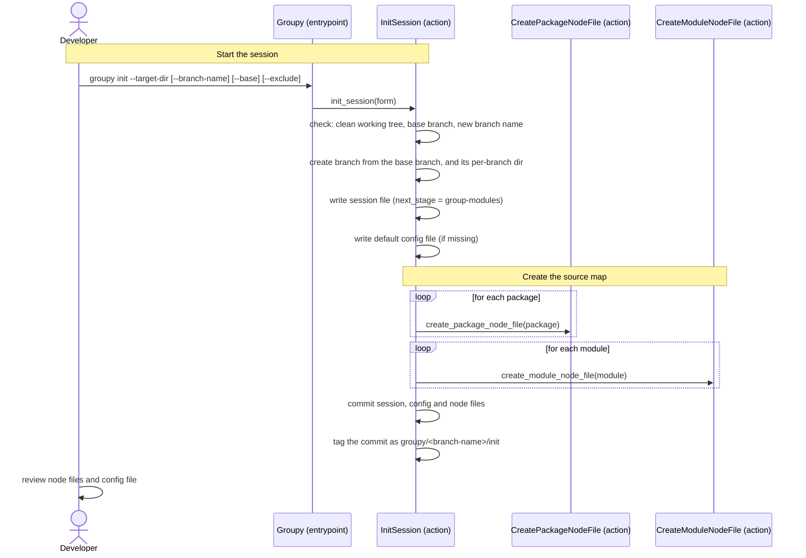

[comment]: <> (This file is auto-generated. Do not edit directly.)

# s01_a_developer_starts_a_session

## A developer starts a session

Groupy is a radical refactoring tool that takes a Python code-base (the *target code*) apart and rebuilds it. Since
it is expected to break the code, the developer helps with fixing errors and testing.

The work is organized in a *session* that runs a fixed sequence of *stages*, one per `groupy next`. A session
starts with `groupy init`, which creates a branch to work on and a *source map* of the target code: a yaml *node
file* per module and package. In the later stages, Groupy and Claude fill the node files with an analysis of the
code (e.g. its concepts, responsibilities and steps), propose changes in them, and apply those changes to the
code. For Groupy, the node files are the record of what was analyzed, proposed and done.

### Steps

#### It checks the preconditions

The developer runs `groupy init --target-dir=<target-dir>` from the repository root.</br>
Groupy first explains the risks, and asks the developer to accept them:</br>

- Groupy radically refactors the code with rope and Claude, which may introduce errors. The developer remains fully
  responsible for the correctness of the code, and reviews all changes (which Groupy commits on the branch).
- Groupy runs Claude Code, which incurs costs, for which the developer is responsible. `groupy status` shows an
  estimate, which comes without any guarantee: the developer checks the actual usage and costs with
  Anthropic.
- Groupy is provided as is, without warranty of any kind.

When the developer declines, `groupy init` changes nothing. The option `--accept-risks` accepts the risks without
being asked (e.g. in a script).</br>
`init_session` refuses to start when the working tree is not clean (`DirtyWorkingTreeError`), when the base branch
doesn't exist (`NoBaseBranchError`), or when the branch already exists (`BranchExistsError`). These checks come
before any change to the repo.</br>

#### It creates the branch, the session file and the config file

A repository can have several sessions, each on a branch of its own (a *groupy branch*). `init_session`
creates the new branch from the *base branch*, which defaults to `main` (`--base=<branch>` chooses another one).
The new branch always starts from the base branch, also when `groupy init` runs on a groupy branch.</br>

- Without `--branch-name`, the branch is named `groupy-<N>` (the first one is `groupy-1`). Groupy never reuses a
  branch name, also not the name of a branch that was aborted.
- A branch name may not contain a `/`.

The files that Groupy doesn't commit (e.g. the logs of Claude and the last run) live in the *per-branch dir*
`.groupy/<branch-name>/`, so that the sessions don't share them. Groupy excludes the per-branch dirs from git
locally (in `.git/info/exclude`), so that no `.gitignore` is needed.</br>
Then Groupy writes the session file (`.groupy/session.yaml`). The session file contains:</br>

- `target_dir`: the dir that contains the target code.
- `base_branch`: the branch that the session started from.
- `next_stage`: the stage that the next `groupy next` runs (initially `group-modules`).
- `exclude`: the glob patterns (relative to the target dir) of the files that the session does not refactor, given
  with `--exclude` (which can be repeated, e.g. `--exclude=myapp/reports/**`). A `*` does not match a `/`, and a
  `**` matches any number of dirs.

The developer may want to refactor only a part of the code-base (e.g. one feature area). The files that match an
`exclude` pattern are *passive*, and the other files are *active*. The stages only analyze and refactor the active
files, but the passive files stay part of the session: they get node files, and the call graph and the context of
the Claude requests cover them. Without patterns, every file is active.</br>

The config file (`.groupy/config.yaml`) holds the choices that the developer makes for the session, such as the
grouping strategy and the maximum sizes of groups and chunks, the policies that Groupy uses to talk to Claude
and to refactor the code, and the Claude model (`claude_model`). A stage may get a model of its own in
`claude_model_by_stage` (e.g. a stronger model for a stage that needs more judgement). The config file may also
have `exclude` patterns, which are added to those of the session file. When the repository has no config file, Groupy writes one that lists every field with its
default value, so that the developer can see what can be configured. An existing config file is kept, so the
developer can prepare it before running `groupy init`. The developer can also change it (and commit the change)
after `groupy init`, e.g. to choose another grouping strategy before the first stage groups the modules.
</br>

#### It creates the node files

Groupy creates a *package node file* (`package-node.groupy.yaml`) in the dir of every package, and a *module node
file* (e.g. `books.py.groupy.yaml`) next to every module (also the passive ones).</br>

- A package is the target dir itself (the root package, with the name `.`), or a dir below it that contains Python
  modules, directly or in a sub-dir. It does not need an `__init__.py` (namespace packages are packages too). Its
  node file lists its `module_names`.
- An `__init__.py` is just another module, so it gets a module node file.
- Paths in node files are relative to the target dir (e.g. `myapp/books.py`).

Initially, a module node file only reflects the structure of the module:</br>

```yaml
module_node:
  name: myapp/books.py
  line_count: 14
  function_nodes:
    - name: create_book
    - name: _normalize_title
  class_nodes:
    - name: Book
      method_nodes:
        - name: __init__
  variable_nodes:
    - name: MAX_CHAPTERS
```

Every top-level function gets a function node, every class a class node (with a node per method), and every
module-level variable a variable node. A function that is nested in the Python code (e.g. a closure) has no node
of its own: it counts as part of the body of its enclosing function. The `helper_function_nodes` of a function node
are still empty: identifying helper functions is the first stage.</br>
Groupy leaves out the fields that have their default value (e.g. `null`, `[]` or `false`), and reads a missing
field as its default value.</br>

#### It commits

Groupy commits the session file, the config file and the node files on the new branch, and tags the commit as
`groupy/<branch-name>/init` (so that `groupy reset init` can return to it). Before running the first stage, the developer can
inspect (and edit) the node files and the config file.</br>

### Diagram



