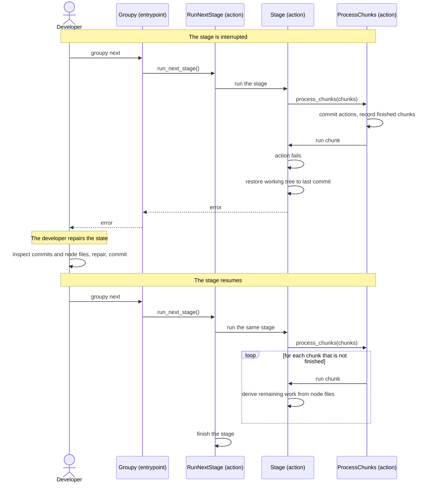

[comment]: <> (This file is auto-generated. Do not edit directly.)

# s03_a_developer_resumes_an_interrupted_stage

## A developer resumes an interrupted stage

Since Groupy changes the code radically, a stage may stop halfway: a refactoring fails, a Claude
request fails, or Groupy detects a problem that Claude could not fix. Groupy is designed so that an interrupted
stage leaves a consistent state that the developer can inspect and repair, and so that running `groupy next`
again continues where the stage stopped, without repeating finished work.

### Steps

#### The stage is interrupted

While a stage processes its chunks, each action that succeeds is committed, and each finished chunk is recorded in
the `finished_chunks` of the session file. 
When an action fails, Groupy restores the working tree to the last commit, which undoes the partial changes of
the action (e.g. a refactoring that changed some files but not all). Then it re-raises the error, which interrupts
the stage. The `next_stage` field of the session is unchanged. 

#### The developer repairs the state

The working tree is clean, and the git history shows which actions succeeded. The developer finds the cause of the
error (e.g. a name clash, or a proposal that cannot be applied), repairs it (e.g. by editing the code or a node
file), and commits the repair. 

#### The stage resumes

The developer runs `groupy next`, which runs the same stage again. 

- `process_chunks` skips the chunks that are recorded in `finished_chunks`.
- Within the interrupted chunk, the stage derives its remaining work from the node files, which reflect the work
  that was already committed. For example, applying a renaming clears it from the node file, so the resumed
  apply-renamings stage only applies the renamings that are left. Likewise, a stage that works on candidates only
  takes the candidates that are not done yet.

When the stage is finished, Groupy moves on to the next stage, as usual. 

### Diagram

