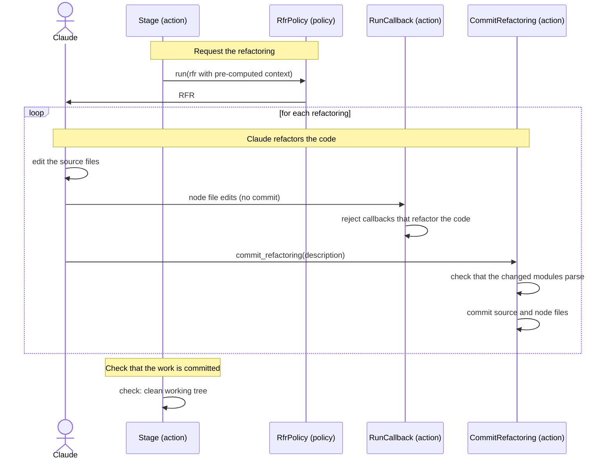

[comment]: <> (This file is auto-generated. Do not edit directly.)

# s04_claude_refactors_code_in_an_rfr

## Claude refactors code in an RFR

Some refactorings cannot be done with a refactoring library (e.g. moving a step from a function to its callers).
For these, Groupy sends Claude a *request for refactoring* (RFR), in which Claude edits the source files directly.
While Claude refactors, the code may be temporarily broken, so an RFR follows other rules than an RFA: callbacks
don't commit, and Claude decides when a refactoring is complete by calling `commit_refactoring`.

An RFR is made by a stage (e.g. apply-move-steps-to-caller, with the id `<stage-id>/<chunk-id>`), or by a callback
that needs a refactoring (e.g. `extract_method`, with the id `<action>/<location>/<name>`). This scenario follows
an RFR made by a stage. An RFR made by a callback works the same, except that Claude does not call
`commit_refactoring`: the callback verifies the result itself (e.g. that the extracted function exists) and commits.

### Steps

#### It requests the refactoring

The stage calls the RFR policy (named in the config file) with an RFR, whose context contains the pre-computed
information that Claude needs (e.g. the sources of the modules and of the callers). 

#### Claude refactors the code

Claude edits the source files directly. It also updates the node files of the code that it changed (e.g. the steps
of the functions), using callbacks. 

- In an RFR, only the node file edits, the glossary edits and `commit_refactoring` are allowed. A callback that
  refactors the code (e.g. `extract_method`) is rejected with `CallbackNotAllowedError`, so that an RFR never
  starts another RFR.
- The callbacks don't commit, because the source may be half-refactored while they run.

When a refactoring is complete, Claude calls `commit_refactoring(description)`, typically once per refactoring.
It checks that the changed Python files parse, and commits the source files and the node files together with the
message `<stage-id>: <description>`. If a file does not parse, Groupy restores the working tree to the last commit
and raises `RefactoringDoesNotParseError`. 

#### It checks that the work is committed

After the RFR, the stage checks that the working tree is clean. Uncommitted changes mean that Claude did not
finish a refactoring, so Groupy restores the working tree to the last commit and raises
`UncommittedRefactoringError`. 

### Diagram

