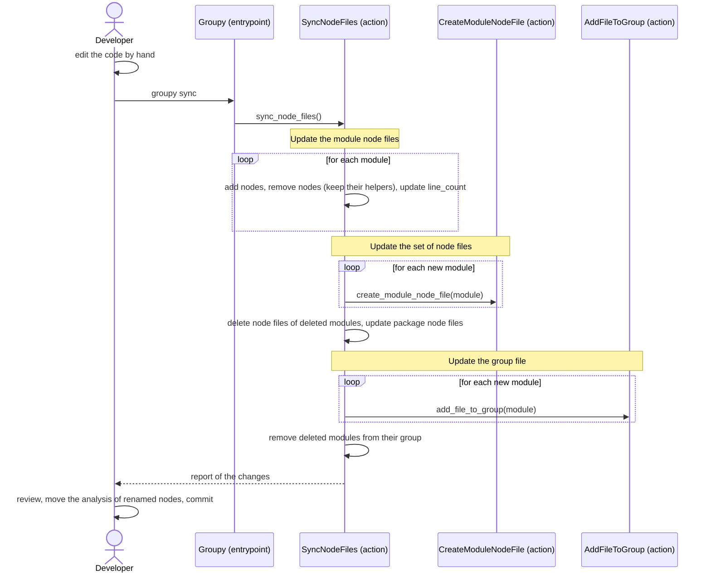

[comment]: <> (This file is auto-generated. Do not edit directly.)

# s05_a_developer_syncs_the_node_files

## A developer syncs the node files

When the developer changes the code by hand (e.g. to repair the state after an interrupted stage), the node files
no longer reflect the structure of the source. `groupy sync` updates the structure of the node files, so that the
next stage works with the right functions, classes and variables. Groupy does not re-evaluate the analysis (e.g.
the concepts and steps): the developer will have to edit the new/changed node-files where needed.

### Steps

#### It updates the module node files

`sync_node_files` compares the structure of each module with its node file. The structure consists of the
top-level functions, the classes and their methods, and the module-level variables.</br>

- Helper function nodes count as top-level functions, because a helper function is a top-level function in the
  source. A function that is nested in the source has no node, so it is not compared.
- A name that is only in the source gets a new node, which is inserted in source order among its siblings.
- A name that is only in the node file loses its node, together with its analysis. The helper function nodes of a
  removed node take its place, so that they keep their own analysis.
- Groupy cannot tell a renamed function from a removed and an added function, so a rename is reported as both.
  The analysis of the removed node is visible in the diff of the node file, so the developer can move it to the new
  node.
- Changes inside a function body are not detected, so the analysis of a changed function may be stale.

#### It updates the set of node files

A new module gets a module node file (and a new package a package node file). The node file of a module that no
longer exists is deleted. The `module_names` of the package node files are updated accordingly.</br>

#### It updates the group file

A new module goes into the group of a module in the same dir, or else into a new group. A deleted module is
removed from its group.</br>

#### It reports the changes

Groupy prints a line per change, sorted by module and location, followed by a request to review the changes:</br>

```
myapp/authors.py: created the node file
myapp/books.py: removed create_book (it had responsibilities)
myapp/books.py: added make_book
myapp/chapters/create_chapter.py: deleted the node file
Please review the changes to the node files (e.g. with git diff), and move the analysis of renamed nodes.
```

A removed node lists the fields that had a value, as a hint to move them. Without changes, Groupy prints
`The node files match the source.`</br>
`groupy sync` does not commit, and does not require a clean working tree. Since `groupy next` requires a clean
working tree, the developer reviews and commits the changes before the next stage.</br>

### Diagram



