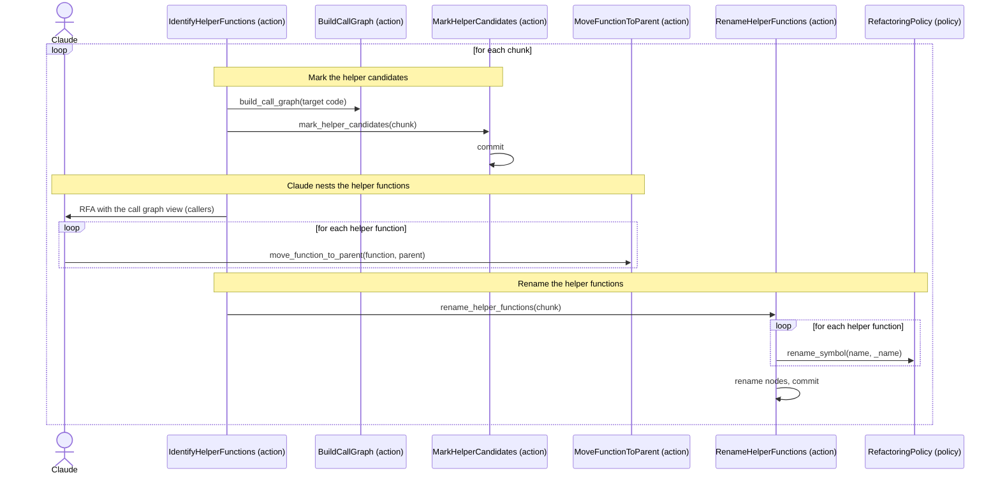

[comment]: <> (This file is auto-generated. Do not edit directly.)

# s06_groupy_identifies_helper_functions

## Groupy identifies helper functions

A helper function is a function that only exists to serve one other function (its parent). Knowing the helper
functions makes the later stages simpler: a helper is analyzed as part of its parent, it moves together with its
parent in the code restructure, and only its parent needs to become an action, rule or util. This stage is also the
first one that uses the call graph and the refactoring policy.

A method is treated like a function that is called in a special way (with a `self` argument), in this stage and in
all other stages. So a method can have helper functions, and a method can be a helper function.

### Steps

#### It marks the helper candidates

Before each chunk, Groupy rebuilds the *call graph* of the target code from scratch, so that each chunk sees the
changes made by the previous chunks (parsing takes seconds, which is small compared to a Claude request). 

- The call graph covers the target code, but not the test code (modules in a `tests` dir, `test_*.py`,
  `*_test.py` and `conftest.py`): a refactoring that breaks a test is done anyway, and the developer fixes the
  tests later. Calls of functions outside the target code (e.g. of the standard library) are not recorded.
- Its nodes are the functions and methods, identified by their path and qualified name (e.g.
  `myapp/books.py:Book.save`). Calls in module-level code are calls of `<path>:@module`. A function that is nested
  in the source is part of its enclosing function: its calls count as calls of the enclosing function.
- Each edge (from caller to callee) is *certain* or *uncertain*. A call is uncertain when Groupy cannot determine
  which function is called: e.g. for `obj.save()`, where the type of `obj` is unknown, there is an uncertain edge to
  every `save` method in the target code. A call of a method of `self` is certain, unless a subclass overrides the
  method.
- The call graph is stored in `.groupy/call-graph.yaml`. It is derived from the code, so it is not committed.

`mark_helper_candidates` sets `is_helper_candidate` on the function nodes of the chunk that have exactly one caller,
where this caller is a function or method in the same module that calls it through a certain edge. Dunder methods
(e.g. `__init__`) are never candidates, because Python calls them. 

#### Claude nests the helper functions

Groupy sends an RFA with a *view* of the call graph for the chunk: for each function, its direct callers, labelled
as being in the same module, in another module of the chunk, or outside the chunk, with the uncertain edges marked.
A function with many callers gets a summary instead (e.g. "called from 37 places in 12 modules"). Each stage
chooses the view that it needs; this stage only passes the callers. When Claude needs more, it can follow the call
graph with the query callbacks `get_callers`, `get_callees` and `get_source`. 
Claude decides which functions are helper functions, taking the uncertain edges into account. Not every candidate
is a helper (e.g. a function that is called by one function, but that is a meaningful operation in itself). For
each helper, Claude calls `move_function_to_parent`, which moves its node to the `helper_function_nodes` of its
parent. This only changes the node file: in the source, a helper function stays a top-level function in the module
of its parent. (A function that is nested in the source is something else: it has no node of its own, and its
names are covered by the analysis of its enclosing function.) 

#### It renames the helper functions

After the RFA, `rename_helper_functions` renames each helper function of the chunk so that it starts with an
underscore (also helpers of helpers and helpers of methods), in the source and in the node file. Renaming per chunk
keeps the node files, the source and the call graph consistent for the next chunk. 
Groupy refactors the code through the *refactoring policy* named in the config file. The default policy uses the
rope library. Its `rename_symbol` renames a symbol in a scope, including its imports and call sites in other
modules. When the new name clashes with an existing name, it raises `RenameConflictError` before it changes any
file; this interrupts the stage, and the developer resolves the clash. 

### Diagram

