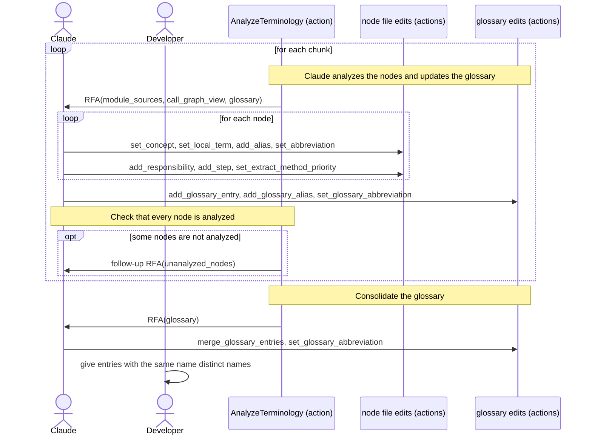

[comment]: <> (This file is auto-generated. Do not edit directly.)

# s07_groupy_analyzes_the_terminology

## Groupy analyzes the terminology

In this stage, Claude analyzes every function and class of the target code: the concepts and terms that it uses,
its responsibilities, and the steps that it takes. Claude also builds a project glossary. The later stages build on
this analysis: the renamings unify the terminology, extract-methods splits functions with too many
responsibilities, and the code restructure uses the responsibilities to decide where code goes.

### Steps

#### Claude analyzes the nodes

Groupy makes an RFA per chunk, whose context contains the source of each module of the chunk (`module_sources`),
the call graph view with the callers and the callees, and the glossary so far. Claude fills in the node files with
callbacks:</br>

- `ModuleNode.concepts`: the concepts that apply to the module as a whole, each mapped onto a short description.
  They are recorded once at the module level, so that they are not repeated in each function node.
- `concepts` of a function or class node: the other concepts that it uses. A concept is a term that helps explain
  the purpose and responsibilities of the code.
- `local_terms` of a function node: terms that are significant in the function, but not in the wider code-base
  (e.g. `hash_tag` in a function that parses hash tags). Claude uses its judgement to tell concepts from local
  terms: concepts are only meaningful when not everything is a concept.
- `responsibilities` and `steps` of a function node (and `responsibilities` of a class node): what the function is
  responsible for, and the steps that it takes to meet its responsibilities, in terms of the concepts and local
  terms. A callback identifies a responsibility or step by its index in the list.
- `aliases` of a function node: when a function uses several names for the same concept (e.g. `outlier` and
  `outlier_point`), Claude records the concept once, under the name that it considers canonical, and lists the
  other names as aliases (`outlier: [outlier_point]`). The aliases are the input for the renamings.
- `abbreviations` of a function node: abbreviations of local terms, and of concepts that have no glossary entry,
  that help to keep names short (e.g. `time_stamp: ts`). The abbreviations of glossary concepts are recorded in the
  glossary instead.
- `extract_method_priority` (`high`, `medium`, `low` or `n/a`): whether the function has too many responsibilities
  and should be split up.

A description of a concept or local term is left empty (`null`) when it is already given elsewhere (e.g. in another
node of the module), unless the meaning in this function is specific.</br>

#### Claude updates the glossary

The project glossary (`glossary.groupy.yaml` in the root of the target dir) records the concepts of the code-base,
and is a guide for choosing names. Each RFA receives the glossary so far, so that Claude can reuse the names and
descriptions of earlier chunks.</br>

```yaml
- name: report
  description: a markdown document with the statistics of a user
- name: report
  description: an error report that is sent to Sentry
  aliases: [error_doc]
- name: title
  description: the name of a book
  aliases: [name, book_title]
  abbreviation: ttl
```

- A concept that is not in the glossary yet gets a new entry (`add_glossary_entry`).
- A concept that has the same meaning as an entry with another name becomes an alias of that entry
  (`add_glossary_alias`).
- A concept that has the same name as an entry, but another meaning, gets an entry of its own with the same name.
  Callbacks then pick the entry by its `meaning_nr` (its position among the entries with that name). Claude does
  not try to resolve such names; that is up to the developer.
- Long concepts may get an abbreviation (`set_glossary_abbreviation`), so that it is applied consistently across
  the code-base: once an abbreviation is introduced, no alternative abbreviation is used.

All abbreviations (in the glossary and in the node files) are decided in this stage, so that the developer reviews
the entire terminology at once. The renamings use them, but don't introduce new ones.

The glossary does not record where its concepts are used, and the concepts in the node files do not need to have an
entry.</br>

#### It checks that every node is analyzed

After the RFA of a chunk, Groupy checks that every function, method, helper function and class node of the chunk
has an `extract_method_priority`. If not, it makes one follow-up RFA (with the id `<rfa-id>/retry-1`) that lists
the unanalyzed nodes. Nodes that are still not analyzed after that raise `UnanalyzedNodesError`, which interrupts
the stage. This pattern (one follow-up request that lists what is missing, then an error) recurs in later
stages.</br>

#### It consolidates the glossary

Since early chunks don't know the later ones, they may have added entries that turn out to have the same meaning.
After the last chunk, Groupy makes one RFA for the entire glossary (`analyze-terminology/consolidate-glossary`).
Claude merges entries with the same meaning (`merge_glossary_entries`, which turns the other names into aliases)
and makes the abbreviations consistent. The consolidation is recorded as a final chunk, so that a stage that is
interrupted during the consolidation only reruns the consolidation.</br>

#### The developer cleans up the glossary

When reviewing the stage, the developer gives entries with the same name distinct names (e.g. `report` for the
user statistics, and `error_report`, with the alias `report`, for the error reports).</br>

### Diagram



