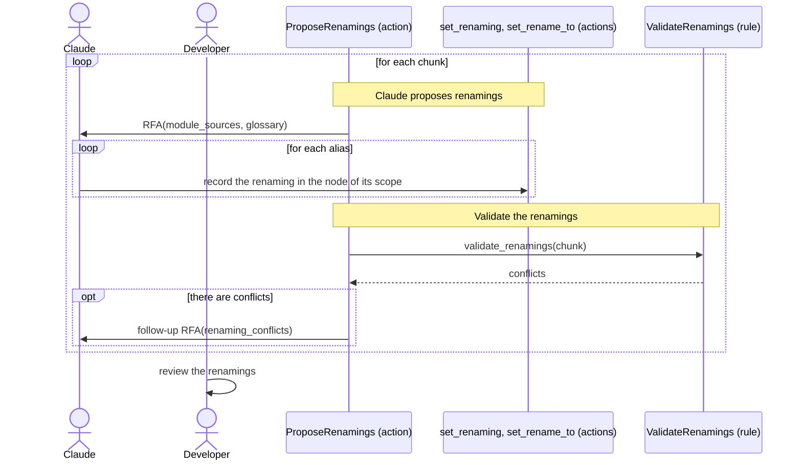

[comment]: <> (This file is auto-generated. Do not edit directly.)

# s08_groupy_proposes_renamings

## Groupy proposes renamings

The analysis showed which names are aliases of the same concept. In this stage, Claude proposes renamings that
replace the aliases by canonical names, preferably those of the glossary. The renamings are only recorded in the
node files: the developer reviews them before the next stage applies them to the code.

### Steps

#### Claude proposes renamings

Groupy makes an RFA per chunk, whose context contains the source of each module of the chunk and the glossary.
Claude reads the concepts and aliases from the node files. It records each renaming in the node of the scope where
the symbol is defined: 

- `renamings` of a function node: its local symbols (variables and parameters), and its concepts and local terms.
- `renamings` of a class node: its attributes.
- `ModuleNode.renamings`: the module-level symbols.
- `rename_to` of a function, class or variable node: a new name for the node itself.

A renaming maps an entire symbol onto its new name (there is no partial matching), and keeps its meaning (e.g.
plural stays plural). E.g. when a function uses `outlier_point` as an alias of `outlier`, then
`new_outlier_points` becomes `new_outliers` and `find_next_outlier_point` becomes `find_next_outlier`. 

- The glossary is a guide. Claude may rename a concept to the name of a glossary entry with the same meaning (judged
  from its description and the source). When the glossary still has several entries with the same name, Claude
  chooses the entry from the context, or leaves the name unchanged.
- Renamings may also shorten names. A map is named `foo_by_bar`, where `foo` is the value and `bar` the key. The
  abbreviations that analyze-terminology decided may be used: those of the glossary everywhere (e.g.
  `highest_sf_by_plot_id`, where `sf` is the abbreviation of `suitability_fraction`), and those in the
  `abbreviations` of a function node within that function. Claude does not introduce new abbreviations.
- Only symbols that are defined in the target code are renamed, not the attributes, parameters and dict keys of
  external libraries.

#### It validates the renamings

After the RFA of a chunk, Groupy checks the renamings of the chunk for conflicts: 

- A new name that clashes with an existing name in the same scope (that is not itself renamed away).
- Two renamings in the same scope with the same new name.
- A cycle (e.g. swapping `title` and `text`), since it cannot be applied without a temporary name. A chain (e.g.
  `title -> text` and `text -> body`) is allowed: it is applied in the right order.

Each conflict is a line such as
`myapp/reports.py:create_report: title -> text clashes with the existing name text`. When there are conflicts,
Groupy makes one follow-up RFA that lists them. Conflicts that remain raise `ProposedRenamingHasConflictError`,
which interrupts the stage. 

#### The developer reviews the renamings

The source is unchanged. The developer reviews (and possibly edits) the proposed renamings in the node files
before running the next stage. 

### Diagram

