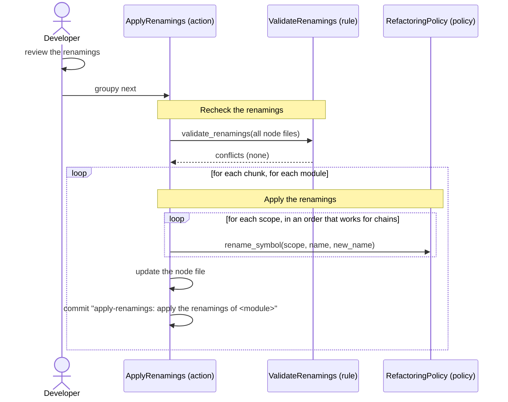

[comment]: <> (This file is auto-generated. Do not edit directly.)

# s09_groupy_applies_renamings

## Groupy applies renamings

In this stage, Groupy applies the renamings that the developer has reviewed to the code, using the refactoring
policy. It makes no Claude requests: the renamings are fully specified in the node files.

### Steps

#### It rechecks the renamings

Since the developer may have edited the renamings during the review, Groupy first checks all renamings for
conflicts (as in propose-renamings), before it changes anything. Conflicts raise
`ProposedRenamingHasConflictError`, which lists them. Since a module whose renamings were applied has no renamings
left, the check also works when the stage is resumed. 

#### It applies the renamings per module

Groupy processes the chunks, and the modules of a chunk in sorted order. Per module, it applies all renamings of
its node file: the `renamings` of the module, its classes and functions, and the `rename_to` of its functions,
methods and classes. 

- Each renaming of a symbol is done with `rename_symbol` of the refactoring policy, which also updates the imports
  and call sites in other modules.
- Within a scope, Groupy orders the renames so that a chain works (e.g. for `title -> text` and `text -> body`, it
  renames `text` first).
- A renaming whose old name is not a symbol in the source (e.g. a concept such as `outlier_point`) only renames the
  keys in the node file.

#### It updates the node file

For each node whose renamings were applied: 

- `name` becomes the `rename_to`, and `rename_to` is cleared.
- The keys of `concepts`, `local_terms` and `abbreviations` are renamed, all at once (so `text -> body` and
  `body -> content` turn the keys `text` and `body` into `body` and `content`).
- `renamings` and `aliases` are cleared, because the aliases are gone.

Groupy commits per module, with the message `apply-renamings: apply the renamings of <module>`. When a rename
fails, Groupy restores the last commit, which also undoes the renames of the module that already succeeded; the
module keeps its renamings, so the resumed stage starts again at that module. 

### Diagram

