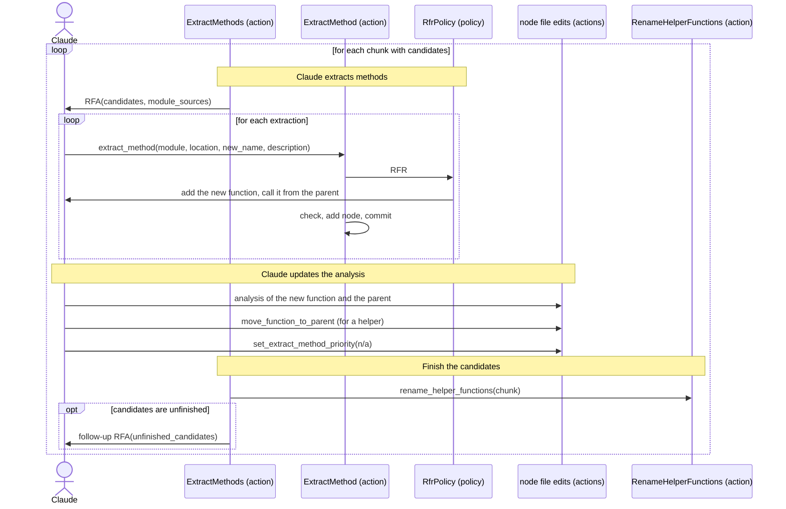

[comment]: <> (This file is auto-generated. Do not edit directly.)

# s10_groupy_extracts_methods

## Groupy extracts methods

The analysis marked the functions that have too many responsibilities with a high or medium
`extract_method_priority`. In this stage, Claude splits these functions by extracting parts of them into new
functions. Extracting a step into its own function also prepares the later stages: such a step can then move to a
caller as a single function call, or go to a file of its own in the code restructure.

### Steps

#### It selects the candidates

The candidates are the function, method and helper function nodes with the priority `high` or `medium`. Groupy
makes an RFA per chunk that has candidates, whose context lists the candidates (the `high` ones first) and the
sources of the modules. A chunk without candidates is finished without an RFA. 

#### Claude extracts methods

For each extraction, Claude calls `extract_method(module_name, location, new_name, description)`. This callback
makes an RFR in which Claude adds the top-level function `new_name` to the module (also when it extracts from a
method) and calls it from the parent. 
After the RFR, `extract_method` checks that the module has the new function and that the parent still exists. If
not, Groupy restores the last commit and raises `ExtractMethodFailedError`. Otherwise, it adds a node for the
extracted function to the node file (in source order), and commits. 

#### Claude updates the analysis

In the same RFA, Claude fills in the analysis of the extracted function (e.g. its concepts, responsibilities and
steps), and updates the analysis of the parent. When the extracted function is a helper function of the parent,
Claude nests it with `move_function_to_parent`. 
Claude sets the `extract_method_priority` of a candidate to `n/a` when it is done with it, also when it decides not
to extract anything. 

#### It finishes the candidates

After the RFA, Groupy renames the new helper functions so that they start with an underscore (as in
identify-helper-functions). Candidates that still have the priority `high` or `medium` get one follow-up RFA;
candidates that remain unfinished raise `UnfinishedCandidatesError`, which interrupts the stage. 

### Diagram

