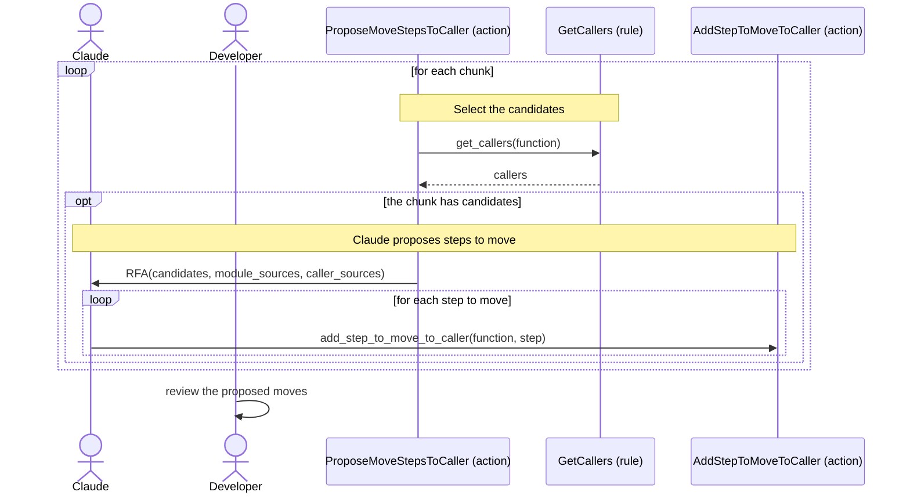

[comment]: <> (This file is auto-generated. Do not edit directly.)

# s11_groupy_proposes_to_move_steps_to_the_caller

## Groupy proposes to move steps to the caller

Sometimes a function F takes a step that belongs to its caller (e.g. checking a permission before creating a
report). Moving such a step to the caller makes F more focused, and makes it easier to classify F in the code
restructure. Since moving a step changes the behaviour for every caller of F, the work is split over two stages:
in this stage Claude proposes the moves, and the developer reviews them before the next stage applies them.

### Steps

#### It selects the candidates

The candidates are the function, method and helper function nodes that have at least one caller, where all callers
are functions or methods that call them through a certain edge (not module-level code). Groupy makes an RFA per
chunk that has candidates; a chunk without candidates is finished without an RFA. 

#### Claude proposes steps to move

The context of the RFA contains the candidates, the sources of the modules of the chunk, and the source of each
caller of a candidate (`caller_sources`, also for callers in other modules). 
Claude records each step that should move in the `steps_to_move_to_caller` of the function node, with
`add_step_to_move_to_caller`. The step must be one of the `steps` of the function. 

- Typically, the extract-methods stage already extracted such a step into a function of its own, so that moving
  the step means moving a single function call.
- A step is only moved when F has a single caller, or when all callers of F should clearly perform it. Otherwise,
  moving the step would duplicate code.
- Moving steps is optional, so Groupy does not check that Claude considered every candidate.

#### The developer reviews the proposed moves

The source is unchanged. The developer reviews (and possibly edits) the proposed moves in the node files before
running the next stage. 

### Diagram

