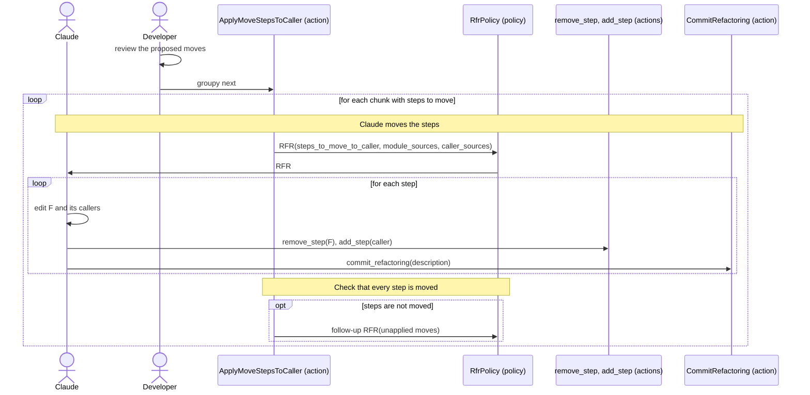

[comment]: <> (This file is auto-generated. Do not edit directly.)

# s12_groupy_moves_steps_to_the_caller

## Groupy moves steps to the caller

In this stage, Claude applies the moves that the developer has reviewed: it moves each proposed step of a function
F to the callers of F, and updates the analysis of F and of its callers. Since this changes the source, the stage
makes an RFR rather than an RFA.

### Steps

#### Claude moves the steps

Groupy makes an RFR per chunk that has steps to move (with the id `apply-move-steps-to-caller/<chunk-id>`); a chunk
without steps to move is finished without an RFR. The context contains the steps to move (as lines
`<module>:<location>: <step>`), the sources of the modules of the chunk, and the source of each caller of a function
whose steps move (also in other modules). 
For each move, Claude edits F and its callers, removes the step from the steps of F (which also removes it from
`steps_to_move_to_caller`), adds it to the steps of the callers, and calls `commit_refactoring`. As in any RFR, the
callbacks don't commit by themselves, and work that is not committed is rejected. 
When Claude finds that a step cannot be moved after all, it withdraws the proposal with
`remove_step_to_move_to_caller`. 

#### It checks that every step is moved

After the RFR, Groupy makes one follow-up RFR for the steps that are still in `steps_to_move_to_caller`. Steps that
remain raise `UnappliedStepMovesError`, which interrupts the stage. The moves that were committed stay
committed. 

### Diagram

