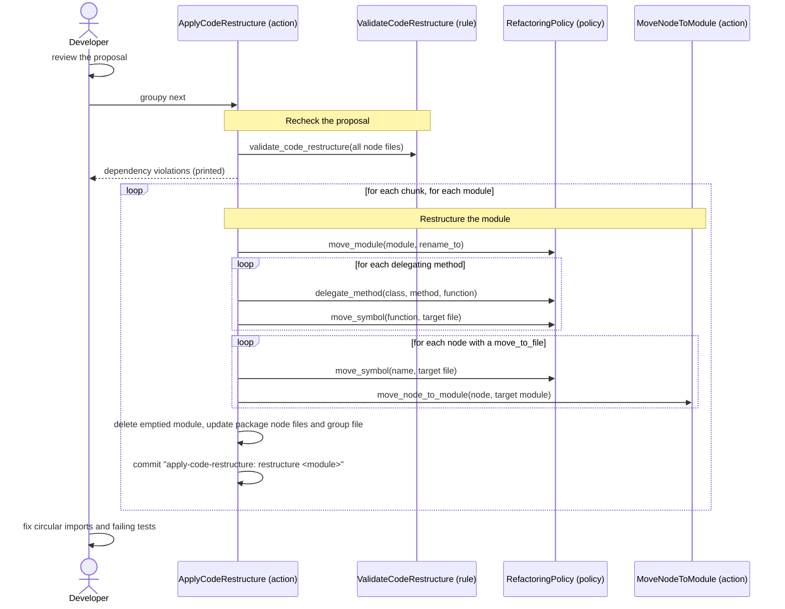

[comment]: <> (This file is auto-generated. Do not edit directly.)

# s15_groupy_restructures_the_code

## Groupy restructures the code

In the last stage, Groupy applies the code restructure that the developer has reviewed: it renames modules, lets
methods delegate to new functions, and moves the code units to their target files, using the refactoring policy so
that the imports and call sites in the code-base follow. It makes no Claude requests. After this stage, `next_stage`
is `done`.

### Steps

#### It rechecks the proposal

Since the developer may have edited the proposal, Groupy validates it again (as in propose-code-restructure)
before it changes anything. Problems raise `CodeRestructureHasProblemsError`. Since the restructured modules have no
proposal left, the check also works when the stage is resumed. Dependency violations are only printed, because the
developer may have accepted them.</br>

#### It restructures each module

Groupy processes the chunks, and the modules of a chunk in sorted order. Per module, it uses three refactorings of
the refactoring policy (which uses rope's "move module" and "move global" refactorings):</br>

1. `move_module` renames the module to its `rename_to`, so that the code units that stay end up in their final
   file. The node file is renamed with it, and the module keeps its group.
2. `delegate_method` lets each method with a `move_to_file` delegate: it adds a top-level function with the body of
   the method, where `self` is replaced by a parameter named after the class (e.g. `report`), and the method body
   becomes a call of that function. `move_symbol` then moves the function (with the helper functions of the method)
   to its target file. To avoid a circular import, the delegating method imports the new function locally:

   ```python
   def render(self):
       from myapp.reports.rules.render_report import render_report
       return render_report(self)
   ```

   The new function gets a function node with the analysis of the method. The method node stays in its class, with
   `Delegates to render_report` as its only responsibility.
3. `move_symbol` moves each top-level node with a `move_to_file` to its target file, in source order. A function
   moves with its helper functions, and a class with its methods. The node moves to the node file of the target
   module, keeping its analysis and its `code_unit_type`.

A target module that does not exist yet is created, with a node file. A new package gets an empty `__init__.py` and
a package node file. A new module goes into the group of the module that its code came from. A module that no
longer contains any code (other than an `__init__.py`) is deleted, together with its node file.</br>
Groupy commits per module, with the message `apply-code-restructure: restructure <module>`. Since the proposal fields
of a restructured module are cleared, a stage that is interrupted by a failed refactoring resumes with the remaining
modules.</br>

#### The developer fixes the remaining problems

Groupy does not try to fix the circular imports or failing tests that the restructure causes. After the stage, the
developer runs the tests and fixes the remaining problems (e.g. by moving a constant, or by adding a
`typing.TYPE_CHECKING` guard). The next `groupy next` prints `The refactoring is done.`</br>

### Diagram



