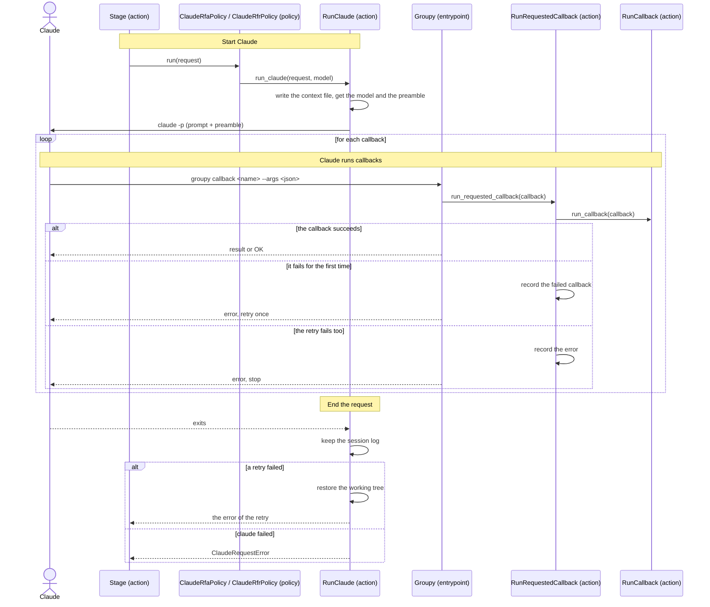

[comment]: <> (This file is auto-generated. Do not edit directly.)

# s16_claude_answers_a_request

## Claude answers a request

The stages send their requests (RFAs and RFRs) to the policies that the config file names. The default policies,
`ClaudeRfaPolicy` and `ClaudeRfrPolicy`, let Claude Code answer each request in a session of its own, in which
Claude runs Groupy's callbacks with a command. This scenario describes how a request is answered; the scenarios of
the stages describe what Claude does in it. The tests use fake policies instead (see s02).

### Steps

#### It starts Claude

The policy calls `run_claude` with the request, which runs `claude -p` in the repo dir. Every request gets a fresh
session, so that a request only depends on its prompt and its context. 

- The context of the request is written to `.groupy/requests/<request-id>/context.yaml`, instead of being inlined in
  the prompt.
- The prompt is the prompt of the request, followed by a *preamble* (`get_preamble`) that explains where the target
  code and the context are, how to run a callback, how to name a node (its location), and which callbacks exist,
  with their arguments.
- The model is the `claude_model` of the config file, unless `claude_model_by_stage` gives the current stage a model
  of its own (`get_claude_model`). An empty model is the default model of Claude Code.
- In an RFA, Claude may only read files and run callbacks. In an RFR, it may also edit files directly (see s04).
- The output of the session is kept in `.groupy/logs/<request-id>.jsonl`, for debugging. Neither the request dir nor
  the logs are committed.

#### Claude runs callbacks

Claude runs each callback with `groupy callback <name> --args '<json>'`, which calls `run_requested_callback`.
That action runs the callback with `run_callback` (in RFR mode for an RFR), just as the fake policies do, so the
callbacks commit as described in s02 and s04. The command prints the result of the callback (e.g. the source of a
function for `get_source`), or `OK`. It always runs in the repo dir, also when Claude has changed its directory.
 

#### A failed callback may be retried once

When a callback fails, the command prints the error, and offers Claude to correct the call and retry it once. A
failed callback is recorded in the request dir (`failed-callback.yaml`), and the next callback that succeeds clears
it. 
When the next callback fails too, the request ends: Groupy records the error (`error.yaml`), tells Claude to stop,
and refuses every later callback of the request. Claude stops by ending its answer. If it doesn't, Groupy stops
`claude` after a few minutes. 

#### It ends the request

When `claude` exits, `run_claude` checks the request dir. After a failed retry, it restores the working tree (which
also undoes the files that Claude edited after the failure in an RFR) and raises the error of the retry, which
interrupts the stage (see s03). When `claude` itself fails (e.g. it cannot reach Claude), it raises
`ClaudeRequestError` with the end of the error output. On Ctrl+C, Groupy stops `claude` and restores the working
tree. 
Afterwards, the stage checks the result as usual, e.g. with a follow-up request (see s07). 

### Diagram

