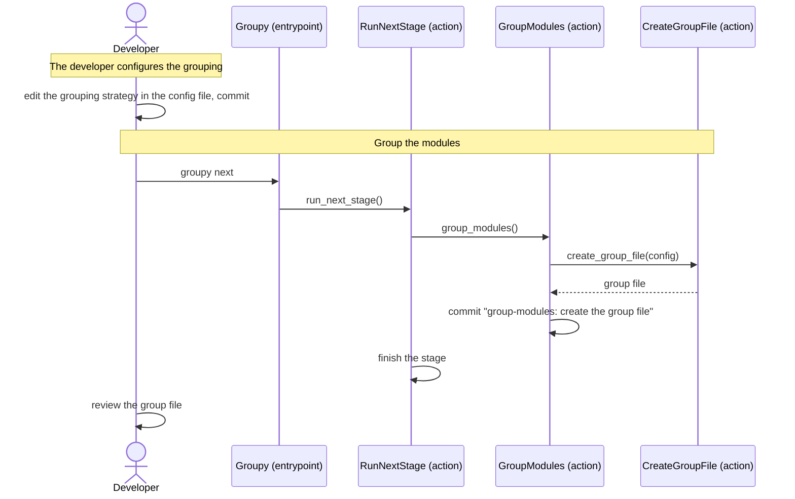

[comment]: <> (This file is auto-generated. Do not edit directly.)

# s17_groupy_groups_the_modules

## Groupy groups the modules

To keep the workload per Claude request reasonable, the stages process the modules in *groups*, and the groups in
chunks. The first stage, group-modules, assigns each module to a group. Since it is a stage of its own
(and not part of `groupy init`), the developer can choose how the modules are grouped in the config file that
`groupy init` wrote, before the grouping happens.

### Steps

#### The developer configures the grouping

After `groupy init`, the developer may change the grouping strategy and the maximum group size in the config file
(`.groupy/config.yaml`), and commits the change. 

#### It groups the modules

The developer runs `groupy next`. Unlike the other stages, group-modules runs without a group file (it creates
one). The stage calls `create_group_file`, which assigns each module to a group, using the grouping strategy and
the maximum group size in the config file: 

- `simple`: the modules, sorted by path, are divided into groups of at most `max_group_lines` lines.
- `package` (the default): a group contains the entire file-tree of a sub-package of a top-level package (e.g.
  `myapp/books`); the modules directly in a top-level package form a group of their own.

It writes the group file (`.groupy/groups.txt`), which assigns each module (by its path, e.g. `myapp/books.py`) to
a group, and commits it with the message `group-modules: create the group file`. Then the stage finishes as usual.
The stage makes no Claude requests. 

#### The developer reviews the group file

The developer reviews the group file, and may edit it (e.g. to move a module to another group) before running the
next stage. 

### Diagram

