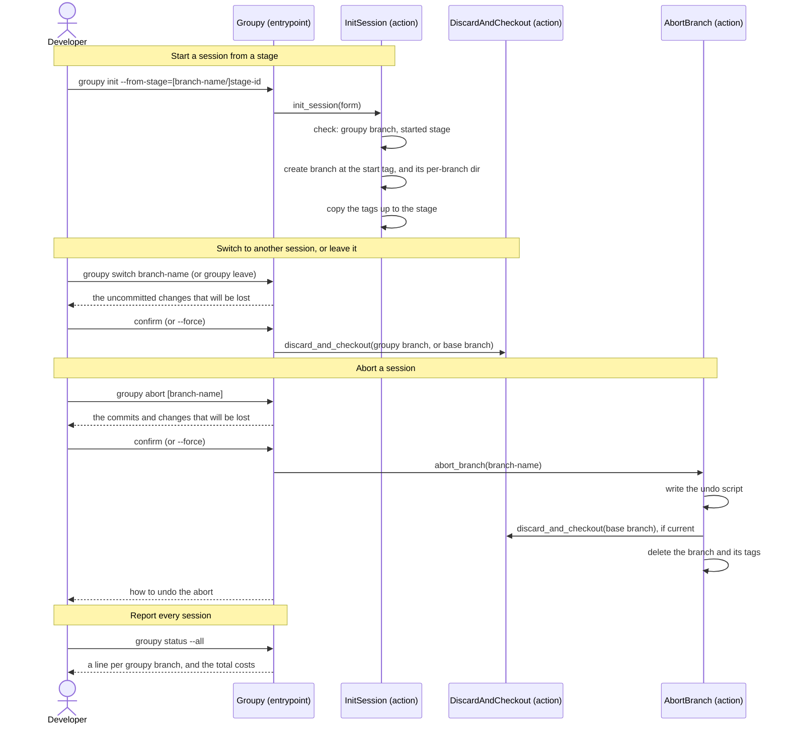

[comment]: <> (This file is auto-generated. Do not edit directly.)

# s18_a_developer_works_on_several_sessions

## A developer works on several sessions

A repository can have several sessions, each on a branch of its own. A *groupy branch* is a local branch that has a
session file. Groupy works on the session of the current branch, so the developer may try another approach on a
new branch (e.g. another grouping strategy, or a stage that is redone), and keep the branches side by side.

### Steps

#### It starts a session from a stage

`groupy init --from-stage=<stage-id>` creates a new branch at the start tag of a stage of the current branch, so that
the developer can redo the stage on a new branch. `--from-stage=<branch-name>/<stage-id>` takes the stage of another
groupy branch, and `init` instead of a stage id takes the start of the session.</br>

- `init_session` raises a `NoGroupyBranchError` when the branch is not a groupy branch, and a
  `StageNotStartedError` when the stage has not started.
- The new branch starts at the tagged commit, without a commit of its own, so its session file and config file are
  those of the stage, with the same target dir and base branch. The new branch is named like any new branch, and
  gets a per-branch dir.
- Groupy copies the init tag and the start tags of the stages up to and including the stage to the new branch,
  so that `groupy next` resumes the stage there, and `groupy reset` works as usual.

#### It switches to another session

`groupy switch <branch-name>` checks out another groupy branch (`get_groupy_branch_session` raises a
`NoGroupyBranchError` for a branch without a session), and prints its next stage. Since `groupy switch` loses the
uncommitted changes, it first says what will be lost and asks for confirmation, like `groupy reset` (`--force` skips
it). The per-branch dirs are excluded from git, so they are kept.</br>

#### It leaves the session

`groupy leave` checks out the base branch of the session, and keeps the groupy branch, so that the developer can
come back to it with `groupy switch`. Like `groupy switch`, it asks before it discards uncommitted changes.</br>

#### It aborts a session

`groupy abort` deletes the current groupy branch and its tags, and goes back to the base branch.
`groupy abort <branch-name>` deletes another groupy branch, and stays on the current branch.</br>

- Groupy says what will be lost and asks for confirmation. The commits that are lost are those that are on no
  other branch (`get_lost_commit_count`): a branch that started from a stage shares its first commits with the
  branch that it started from. The uncommitted changes are only lost when the aborted branch is the current branch.
- `abort_branch` writes an undo script (`.groupy/<branch-name>/undo-abort.sh`) that recreates the branch and its
  tags at the commits where they were. It cannot restore the uncommitted changes.
- The per-branch dir is kept, so that the logs (and the costs) of the session stay available, and the branch name
  is not reused.

#### It reports every session

`groupy status --all` prints a line per groupy branch, also when the current branch has no session (e.g. the base
branch). The line gives the next stage (read from the session file of the branch, without a checkout), the result
of the last run, and the costs of Claude. The current branch is marked with `*`. An aborted branch has a per-branch
dir but no branch anymore: it is listed with its costs. The total of the costs comes last, e.g.

```
* groupy-1: next stage analyze-terminology, last run finished, costs 0.25 USD
  groupy-2: next stage group-modules, no run yet, costs at least 0.05 USD
  groupy-3 (aborted): costs 0.20 USD
Total costs: at least 0.50 USD
```

### Diagram



